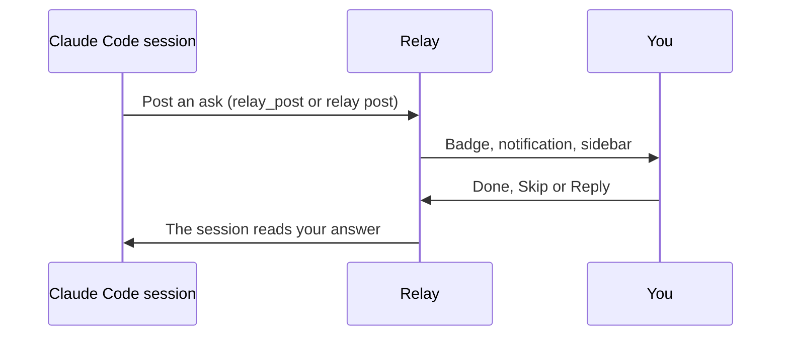

<p align="center">
  <!-- logo: docs/assets/relay-logo.png -->
</p>

# Relay

Everything your Claude Code sessions need from you, in one calm queue on your Mac.

[](https://github.com/xooxoxxo/relay/actions/workflows/ci.yml)
[](LICENSE)

<!-- screenshot: docs/assets/sidebar.png -->

When a session needs a key, a decision or a manual step, it posts an ask: numbered steps with commands to copy. You follow them in a sidebar and press Done, Skip or Reply. The session reads your answer.

## How it works



Relay runs in one of two modes. **This Mac only** is the default, and nothing leaves the Mac. **Mailbox** uses a server you run, so asks reach you away from the Mac (see the [mailbox protocol](docs/mailbox-protocol.md)).

## Quick start

You need macOS 14.5 or later to build, the Xcode Command Line Tools and Python 3.9 or later.

```bash
git clone https://github.com/xooxoxxo/relay.git
cd relay
./scripts/install.sh --local
```

1. In Settings › Connect, copy the CLAUDE.md section and paste it into `~/.claude/CLAUDE.md`.
2. In Settings › Queue, click Send a test ask.

## Documentation

| Topic | Page |
|---|---|
| Install, update, uninstall | [install.md](docs/install.md) |
| Sidebar, keys, Settings | [using.md](docs/using.md) |
| MCP, `relay` command, hook | [claude-code.md](docs/claude-code.md) |
| Ask format | [instructables.md](docs/instructables.md) |
| Config file | [configuration.md](docs/configuration.md) |
| Problems | [troubleshooting.md](docs/troubleshooting.md) |
| Build and test | [development.md](docs/development.md), [CONTRIBUTING.md](CONTRIBUTING.md) |
| API, mailbox, security | [local-api.md](docs/local-api.md), [mailbox-protocol.md](docs/mailbox-protocol.md), [security.md](docs/security.md) |

## License

MIT. See [LICENSE](LICENSE).
