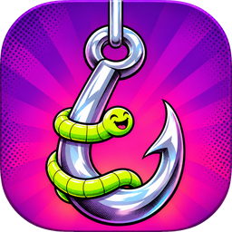

<p align="center"></p>

<h1 align="center">Hook</h1>

Hook (formerly Relay) is a macOS menu-bar inbox for your coding agents: Claude Code, Codex, Cursor and [more](docs/agents.md#the-agents). When a session needs a key, a decision or a manual step, it lands here as a checklist you tick off.

[](https://github.com/xooxoxxo/hook/actions/workflows/ci.yml)
[](LICENSE)

Homepage and product guide: [xooxoxxo.github.io/hook](https://xooxoxxo.github.io/hook/)

<!-- screenshot: docs/assets/sidebar.png -->

How an ask goes:

- Your session posts an ask: numbered steps with copy-paste commands.
- You follow it in the sidebar and press Done, Skip or Reply.
- The session carries on with your answer.

Runs entirely on your Mac by default. Optional [Pond mode](docs/mailbox-protocol.md) forwards asks to you when you are away from it: the Pond (formerly called the mailbox) is a small server you run.

For people who run coding agents on a Mac and want one place to answer what their sessions are waiting on.

## Quick start

You need macOS 14+ and Python 3.9+. Nothing is compiled on your Mac.

1. Download `Hook-<version>.dmg` from the [latest release](https://github.com/xooxoxxo/hook/releases/latest). It is signed and notarized by Apple.
2. Open it and drag Hook to Applications.
3. Open Hook from Applications. At its first launch it installs the `relay` command, MCP server and skill to `~/.local/share/hook`, sets up the agents it finds, and opens its setup window. Hook then updates itself (Check for Updates…).

Or install from Terminal:

```bash
curl -fsSL https://raw.githubusercontent.com/xooxoxxo/hook/main/scripts/get.sh | bash
```

It downloads the latest release, checks it against the release's `SHA256SUMS`, and installs Hook.app to `~/Applications` and the rest as above. Installer options go after `bash -s --`, for example `| bash -s -- --local`. To build from source instead, see [development.md](docs/development.md#build-from-source).

Once Hook runs:

1. Right-click the menu-bar icon and choose Settings… › Agents: each agent and what Hook set up in it. A step only you can do, such as trusting Hook's hook in Codex, arrives as an ask.
2. In Settings › Queue, click Send a test ask. A badge appears on the menu-bar icon; open the ask and press Done.

## Documentation

| I want to | Page |
|---|---|
| Install, update, uninstall | [install.md](docs/install.md) |
| Use the sidebar and shortcuts | [using.md](docs/using.md) |
| Set up my agents (MCP, CLI, hooks) | [agents.md](docs/agents.md), [claude-code.md](docs/claude-code.md) |
| Write an ask | [instructables.md](docs/instructables.md) |
| Fix a problem | [troubleshooting.md](docs/troubleshooting.md) |
| See what Hook records and sends | [privacy.md](docs/privacy.md) |
| Contribute | [CONTRIBUTING.md](CONTRIBUTING.md) |

Everything else: [docs/](docs/README.md).

## License

MIT. See [LICENSE](LICENSE).
